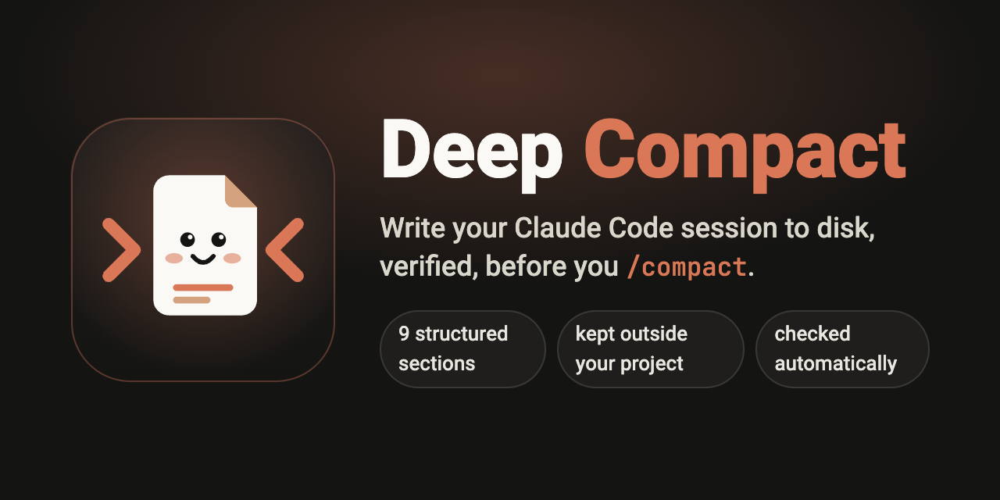
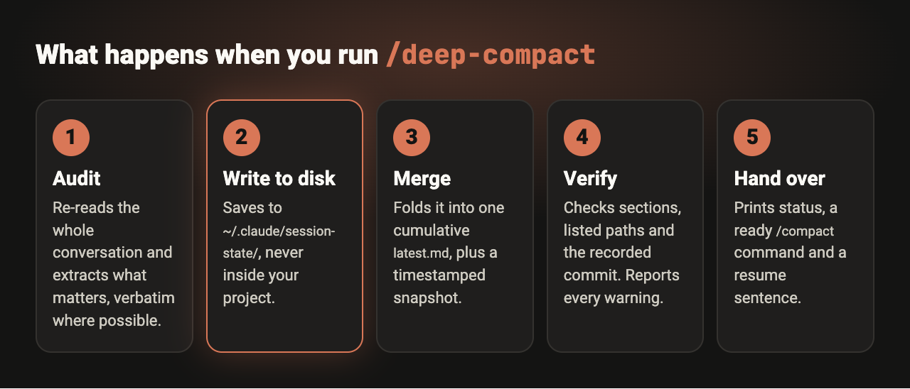
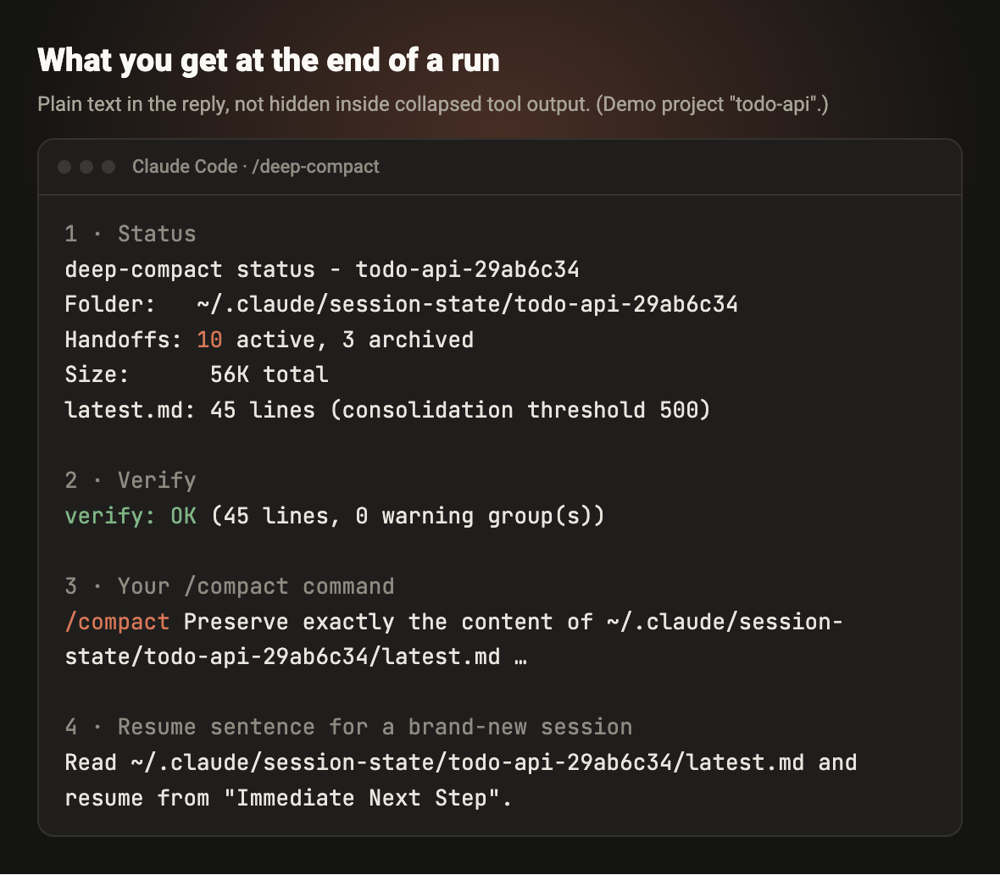
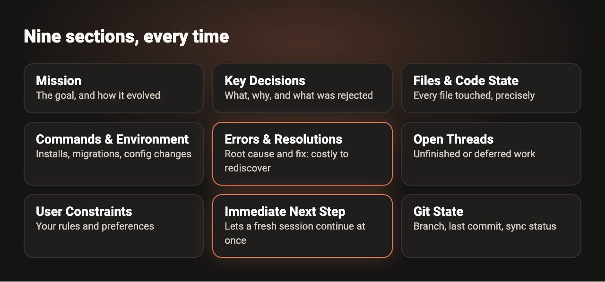
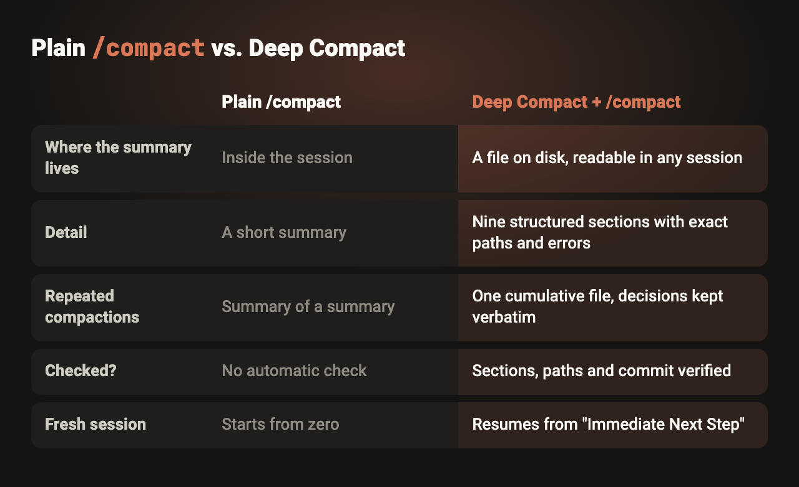

<p align="center">
  
</p>

<p align="center">
  <a href="LICENSE"></a>
  
  
</p>

**Deep Compact** is a [Claude Code](https://docs.claude.com/en/docs/claude-code) skill for long sessions. Before you run `/compact`, it writes everything a competent engineer would need to resume the work into a structured file on disk, checks that file, and hands you a ready-made `/compact` command that points at it.

The point: your context no longer depends only on the compaction summary that lives inside the session.

> Not affiliated with or endorsed by Anthropic. "Claude" and "Claude Code" are trademarks of their owner.

## Why

`/compact` shrinks a long conversation into a short summary that stays inside that session. That is usually fine, but short summaries lose detail: exact file paths, error messages, the reasoning behind a decision, what you already rejected. After several compactions in a row you are working from a summary of a summary, and a brand-new session starts from zero.

## What it does

<p align="center"></p>

1. **Audit.** Re-reads the whole conversation and extracts what matters, verbatim where possible.
2. **Write to disk** under `~/.claude/session-state/<project-id>/`, never inside your project.
3. **Merge** into one cumulative `latest.md`, plus a timestamped snapshot per run.
4. **Verify** that all nine sections exist, that the files it lists really exist, and that the recorded commit matches `HEAD`.
5. **Hand over** a status report, a ready `/compact` command, and a one-line resume sentence for a new session.

### What you see at the end of a run

<p align="center"></p>

The report is plain text in the reply (not hidden inside collapsed tool output). All values above come from a real run on a made-up demo project; see [`examples/`](examples).

### The nine sections

<p align="center"></p>

## Install

Pick one. All three install for **every project** on your machine.

### Option A: as a plugin (recommended)

Inside Claude Code:

```text
/plugin marketplace add Numb2k/Deep-Compact
/plugin install deep-compact@deep-compact
```

Or from a regular terminal:

```bash
claude plugin marketplace add Numb2k/Deep-Compact
claude plugin install deep-compact@deep-compact
```

### Option B: with the `skills` CLI

```bash
npx skills add Numb2k/Deep-Compact --global --yes
```

### Option C: manual copy (no tools needed)

macOS / Linux:

```bash
git clone https://github.com/Numb2k/Deep-Compact.git
cd Deep-Compact
bash install/install.sh
```

Windows (PowerShell):

```powershell
git clone https://github.com/Numb2k/Deep-Compact.git
cd Deep-Compact
powershell -ExecutionPolicy Bypass -File install\install.ps1
```

Or simply copy the folder `skills/deep-compact` to `~/.claude/skills/deep-compact` (Windows: `%USERPROFILE%\.claude\skills\deep-compact`).

> Where it works: the Claude Code CLI, the Claude desktop app's **Code** tab, and the VS Code / JetBrains extensions. They all read the same `~/.claude` folder. Details and troubleshooting: [docs/installation.md](docs/installation.md).

## Use

1. When your context is getting full, type **`/deep-compact`**.
2. Read the report. Then run the **`/compact`** command it printed.
3. In a brand-new session later, paste the resume sentence:

```text
Read ~/.claude/session-state/<project-id>/latest.md and resume from "Immediate Next Step".
```

## Compared with plain `/compact`

<p align="center"></p>

Deep Compact does not replace `/compact`; it prepares it. Plain `/compact` can also take instructions, and that is exactly what the generated command uses. The difference is where the information lives and how it is checked.

## Features

- **Kept outside your project.** Nothing is written inside the repo, so nothing can reach Git, Docker images or a deploy by accident. The helper script never runs a git command that writes.
- **Per-project folders.** The project id is the folder name plus a short hash of its path, so two projects with the same name never collide.
- **Cumulative, not stacked.** One `latest.md` with exactly one set of sections. Decisions, rationale and open threads are not dropped to save space.
- **Snapshots and archive.** The 10 newest snapshots stay in the folder; older ones move (never deleted) to `archive/`, and `latest.md` points there so Claude can search them when you ask about old work.
- **Automatic consolidation** once `latest.md` passes 500 lines, done on a cheaper model, guarded by a deterministic check that fails if even one Key Decisions line was lost.
- **Parallel sessions are safe.** A lock prevents two runs from overwriting each other, and writes are atomic.
- **Works without git.** No repo, no commits, no upstream: each case is handled and reported.
- **Honest verification.** Missing sections fail; stale file paths and commit mismatches are reported as warnings, never hidden.

## Limits (please read)

- **Manual only.** It cannot intercept Claude Code's *automatic* compaction. Run it yourself when the context fills up.
- **Claude cannot run `/compact` for you,** so the skill prints the command and you run it.
- **A new session does not know about the handoff by itself.** Paste the resume sentence.
- **Local to one machine.** Files live in your home folder; they are not synced or shared.
- **Needs `bash`** (macOS, Linux, or Git Bash / WSL on Windows). Windows is **not yet tested**.
- **Built for the Claude Code family,** not the claude.ai web chat, which has no local filesystem for it to write to.
- No cost or speed claims are made: they have not been measured.

More in [docs/limits-and-faq.md](docs/limits-and-faq.md). How it works internally: [docs/how-it-works.md](docs/how-it-works.md).

## Development

```bash
bash tests/run-tests.sh
```

The tests use temporary folders only and never touch your `~/.claude`.

## License

[MIT](LICENSE)
